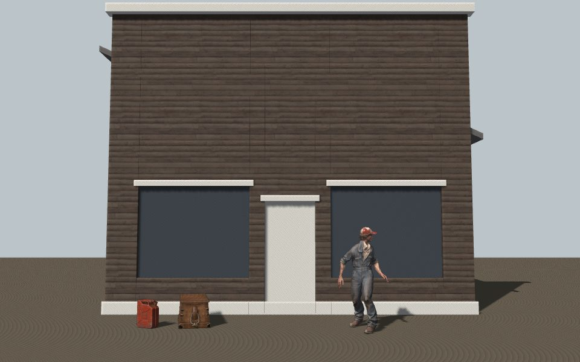

# Asset pipeline

Where the engine build's models, rigs, animations and textures come from, in what format they ship, and what they may
cost. Decided in #33 (the owner's call is recorded in #242); the cast is #40. Style rules are in
[`README.md`](README.md#engine-look), and every source is logged in [`assets.md`](assets.md).

## Decision

| What | Route | Rebuilt by |
| --- | --- | --- |
| Buildings, building kit, furniture blocks, terrain | Procedural: committed TypeScript generators | `make generate/assets` |
| Tiling materials, HDRIs, dressing and hero props | CC0 kits (Poly Haven first), pinned by MD5 | `make generate/assets` |
| PlayCanvas tooling and engine-side assets | PlayCanvas (engine primitives, the glTF loader below) | |
| Hero characters, and a hero prop only when nothing else will do | Image-to-3D on Higgsfield from our concept sheets | `make generate/characters` |
| Animation clips | One shared clip library on one skeleton, retargeted per character | `make generate/characters` |

Higgsfield is for heroes only. The owner has about **50 credits** left this month, with **250 more around
2026-12-08**, when a larger art pass can be planned. A ticket that needs Higgsfield states its credit estimate and
why no CC0 or procedural asset will do; no worker gets the key without such a ticket.

*`game/viewer.html`, rendered in headless Chromium (software GL) by `make test/assets SHOT=...`: the procedural
storefront in CC0 plank siding, the CC0 crate and jerrycan, and Curly (Higgsfield, #60) playing his idle clip.*

## Measured: the routes we can run

Machine: the project's Linux dev box, Node 26, sources cached after the first run. "Time" is `make generate/assets`
wall time per asset, warm cache (the cold first run, downloads included, was 1.1 to 1.3 s per asset). "No meshopt"
and "Shipped" are whole files, textures included; "Gzipped" is what GitHub Pages sends.

| Asset | Route | Time | Source | No meshopt | Shipped | Gzipped | Triangles |
| --- | --- | ---: | ---: | ---: | ---: | ---: | ---: |
| `crate` | CC0 `wooden_crate_02`, 1k | 0.7 s | 2184 KB | 420 KB | 329 KB | 315 KB | 5,176 |
| `jerrycan` | CC0 `metal_jerrycan`, 1k | 0.8 s | 2963 KB | 886 KB | 570 KB | 533 KB | 20,022 |
| `storefront` | procedural false front + CC0 `weathered_plank_siding`, 512 px | 0.2 s | 1607 KB | 70 KB | 58 KB | 50 KB | 264 |

In engine (`make test/assets`, `game/viewer.html`: the three assets above plus the whole core cast loaded, Curly
spawned):

| Measure | Value |
| --- | --- |
| Load, from request to usable asset | storefront 425–549 ms, crate 555–597 ms, jerrycan 571–583 ms, cast 656–746 ms (two runs, local dev server) |
| Bytes fetched | props 0.98 MB (3 files); cast 11.38 MB (40 files) |
| Draw calls | 18 |
| Triangles | 56,688 |
| Texture memory | 188.8 MB |

Human time, from this spike: a CC0 prop took about 10 minutes, almost all of it choosing the asset and pinning its
files; after that it is one manifest entry. The procedural storefront took about an hour of authoring for the first
kit piece; each further variant is a parameter change and 0.2 s.

What it showed:

- **Procedural is by far the cheapest per building** (58 KB, 264 triangles, one shared tiling material) and is fully
  ours. It reads right at street distance; the close-up detail has to come from trim sheets, decals and dressing.
- **CC0 props look finished out of the box** but each brings its own unique 1k texture set. That is fine for hero
  props and does not scale to dressing: the Silver Pan needs at least 180 props ([Density](README.md#density)), and
  180 unique 1k sets are about 3 GB of uncompressed texture memory. Dressing props must be re-textured onto shared
  atlases (or trim sheets) before they enter a space.
- **Texture memory is the binding limit, not download.** The 188.8 MB above matches the arithmetic for uncompressed
  RGBA8 with mips: four characters at one 2k + two 1k maps (134 MB), two props at three 1k maps (34 MB), the
  storefront at three 512 px maps (4 MB) and a 2k shadow map (17 MB). The same set in KTX2 would be about a quarter.

### Image-to-3D (Higgsfield): documented, not run here

This spike had no Higgsfield key and ran no generations. The route is the one #60 used for the core cast, described
under [Characters](#characters) with its measured sizes. Higgsfield does not publish per-task prices; it shows a
quote before each job, and that quote is the number a ticket budgets against. What the project's own jobs cost
(#60, Starter plan):

| Hero asset | Credits | Fits this month's ~50? |
| --- | ---: | --- |
| Reference image (`gpt_image_2_6`) | 0.25 | yes |
| One rigged, textured character (`image_to_3d`, auto-rig) | 35 | yes, once |
| One new library clip (`3d_rigging` with animation) | 8 | after a character, one clip |
| A new character reusing the existing nine clips | about 35 | clips are retargeted for free |
| A static hero prop | not measured; expect up to a character's 35 without rigging | check the quote |

So this month buys **one** new hero (character or prop) plus at most one clip. Everything else waits for the
December credits or goes CC0 or procedural.

## Formats and compression

- **glTF 2.0 binary (`.glb`)**, one file per model and one per clip, served from `game/public/`.
- **Geometry: meshopt (`EXT_meshopt_compression`), not Draco.** The decoder is 28 KB (8 KB gzipped) and comes from
  `meshoptimizer`, already a dependency of the build tools, so no new package. It also compresses animation and
  skinning data, which Draco does not. Draco was not measured: its decoder is a separate WASM module and worker of
  a few hundred KB, for clips it cannot help. Meshopt includes quantization (`KHR_mesh_quantization`), which the
  cast already uses.
  - PlayCanvas 2.23 does not decode meshopt itself. `game/src/props.ts` plugs the decoder into the glTF parser's
    `bufferView.processAsync` hook, and every model in the game, characters included, loads through its
    `loadContainer`.
  - Measured on the shipped cast (not yet switched): characters go from 1.9–2.3 MB to 1.3–1.7 MB (about 26% smaller,
    about 12% after gzip), clips from 16–131 KB to 16–77 KB (about 30% smaller). Switching `tools/characters.ts` to
    meshopt is a follow-up.
- **Textures today: WebP** inside the `.glb` (`EXT_texture_webp`). It shrinks the download, not GPU memory.
- **Textures next: KTX2 with Basis Universal**, as the Materials rules require (UASTC for normal and packed maps,
  ETC1S or UASTC for albedo). It cuts texture memory to about a quarter (see above). Not done in this spike: it
  needs a Basis encoder at build time (KTX-Software's `toktx`, or an encoder package) and the Basis transcoder
  served with the game for `basisInitialize`. Neither is installed and neither was added; picking one is a
  dependency decision for the owner.
- **Texture sizes:** prop sets at 1k (hero density, 512 px/m or more); tiling architecture materials at 512 px
  (about 330 px/m on the 1.57 m siding tile, against the 256 px/m rule); characters as below.

### Size budget per scene

The hard limits stay in [`docs/perf.md`](../perf.md): 40 MB initial download, 512 MB texture memory per space.
Within them, a space's assets are budgeted as follows (gzipped bytes on the wire; texture memory after KTX2):

| Share of a space | Download | Texture memory | Per-asset ceiling |
| --- | ---: | ---: | --- |
| Cast (hero characters and NPCs, with clips) | 12 MB | 150 MB | character 2.5 MB, clip 150 KB |
| Architecture (procedural shells, tiling materials, trim sheets) | 4 MB | 100 MB | building 1.5 MB, material set 1 MB |
| Hero props (5 or so) | 4 MB | 35 MB | 1 MB |
| Dressing props (180 or more, on shared atlases) | 6 MB | 100 MB | 50 KB of geometry each |
| Terrain, sky, lightmaps and probes | 4 MB | 60 MB | |
| **Assets total** (code, audio and UI take the rest of 40 MB) | **30 MB** | **445 MB** | |

Today the prologue's spaces load the cast (11.4 MB) and no art assets besides; the storefront, crate and jerrycan
are in the viewer only.

## Where source files live

Not in Git LFS. Every generated asset is rebuilt from a committed manifest and committed script:

- **Manifests:** `game/assets/environment.json` (CC0 props and materials, procedural buildings) and
  `game/assets/characters.json` (characters and clips). CC0 files are pinned by MD5; a source that changes upstream
  fails the build instead of silently changing the game.
- **Sources** download once into `game/.cache/` (ignored by git). CC0 sources are not committed: they are public,
  pinned, and re-fetchable.
- **Outputs** (`game/public/props/`, `game/public/characters/`) are committed, so the build and CI need no network.
  `make generate/assets` rebuilds the props byte for byte.
- Revisit LFS if the committed outputs pass about 100 MB (today about 12 MB).

## Generators

- `make generate/assets` runs `game/tools/assets.ts`: downloads and checks the CC0 sources, compresses props'
  textures to WebP, builds each procedural building from its parameters with `game/tools/procedural.ts` (pure
  functions, no randomness), then prunes, dedups and meshopt-compresses everything into `game/public/props/`. It
  prints the size table above.
- `make test/assets` runs `game/tools/measure.ts`: loads `game/viewer.html` in headless Chromium and prints load
  times, bytes fetched, draw calls, triangles and texture memory, plus what meshopt would save on the cast.
  `SHOT=<file.png>` saves the frame.
- The procedural kit has one piece so far, the false-front storefront: walls split around door and window openings,
  a gable roof hidden behind the false front, cornice and base trim, world-space UVs so siding lines up across
  pieces. New pieces (log cabin, Quonset hut, plank sidewalk, power pole) are new functions next to it.

## Characters

How a character goes from a concept sheet to a rigged, animated model in `game/`.

Characters are image-to-3D, generated from our own concept sheets, auto-rigged on one shared humanoid skeleton,
and animated with a shared clip library retargeted per character.

We tried this route on one character (Curly) before committing to the rest. It produced a textured, PBR,
rigged model whose face and clothes read clearly at gameplay distance, in about 15 minutes of generation.

### Steps

1. **Reference.** From the concept sheet in `docs/art/concepts/`, generate one clean front view: full body,
   symmetrical A-pose, arms about 45° out, hands clear of the hips, plain light grey background, no props in the
   hands or on the shoulders (props fuse into the mesh). Season-correct clothes: in July, Wade wears fatigues, not
   his parka. Model: `gpt_image_2_6` with the sheet as an image reference.
2. **Model.** Higgsfield `image_to_3d` (Meshy) with texturing, PBR maps, auto-rigging, `pose_mode: a-pose`, the
   character's height, 30k triangles. Output: one skinned mesh, one material (base color, metal-roughness,
   normal), a 24-joint humanoid skeleton (`Hips` … `RightToeBase`).
3. **Clips.** Higgsfield `3d_rigging` with `enable_animation`, run once per clip on one source character (Curly).
   Each output carries his mesh plus one clip; only the animation is kept.
4. **Process.** `make generate/characters` runs `game/tools/characters.ts`, which reads `game/assets/characters.json`
   and writes `game/public/characters/`:
   - downloads each source once into `game/.cache/characters/` (ignored by git);
   - characters: drops the emissive map and the bind-pose clip, resizes base color to 2048 px and the other maps to
     1024 px as WebP, quantizes geometry (`KHR_mesh_quantization`);
   - clips: drops the mesh, keeps rotations plus the `Hips` translation (other bones' translations encode the
     source's bone lengths and would stretch everyone to Curly's proportions), pins root motion in place for clips
     that walk forward, then retargets to each character (below).
5. **Retarget** (`game/tools/retarget.ts`). Rigs share joint names but not rest orientations (Wade's head bone
   rests about 90° off the others'). Both rigs must have the same joints, or the build fails naming the ones
   missing. Each target joint turns from its own rest as the source joint turns from its rest, in the world:
   `q_target = C × (q_clip × inverse(q_sourceRest)) × inverse(C) × q_targetRest`, with
   `C = inverse(P_target) × P_source`, P being each rig's parent rest rotation in the world. Hip translation is
   offset from the target's rest position and scaled by leg length (the ratio of the two rigs' rest hip heights),
   not overall height.
6. **Ground.** Rest poses and leg proportions still differ, so the same joint turns put each rig's feet at a
   different height (before this step Hank's lowest foot hung 4 cm up at idle and 12 cm in the sneak). For every
   key, the hips move up or down so the lowest toe is as far above its rest height as on the clip's own rig,
   scaled by leg length. Measured with forward kinematics on the shipped clips, every character's lowest foot now
   matches Curly's within 2 mm in every clip.

### Shared skeleton and retargeting plan

About 25 characters share one skeleton and one clip library:

- **The skeleton is the 24-joint Meshy humanoid** the core cast already has (`Hips`, spine, neck, head, arms to the
  hands, legs to `*ToeBase`). Every new character, from Higgsfield or a CC0 base, is rigged or renamed onto it.
  No finger bones yet; a hand that holds something uses a socket on the hand bone (a follow-up, with drinking).
- **Clips are authored once, on Curly**, and retargeted per character at build time by the rest-pose formula above,
  so a new character costs no animation credits. A clip from another source (a CC0 animation set, a capture) first
  gets a joint-name map onto the 24 names, then goes through the same retarget.
- **NPCs beyond the heroes** come from a small number of base bodies on the same skeleton, re-dressed and re-tinted,
  sharing texture sets ([Characters](README.md#characters): NPCs share sets or drop a mip). Each is one manifest
  entry pointing at a base, a height and a set.
- **Root motion is pinned** on the horizontal plane; the game moves the entity and scales playback by speed
  (`playbackRate` in `game/src/cast.ts`).

### Numbers

| | Raw | Processed |
| --- | --- | --- |
| One character | 13.8 MB | 1.9–2.3 MB |
| Nine clips, one character | 9 × 13.8 MB | about 650 KB |
| Whole cast (4 characters × 9 clips) | | about 11 MB on disk |

Cost on the Higgsfield Starter plan (about 270 credits a month): reference image 0.25, character 35, clip 8.
The core cast and the first nine clips cost about 215 credits.

### Known limits

- One texture set per character at 2k base color. Close-up dialogue gets a sharper head set later (#40).
- Textures are WebP, which shrinks the download but not GPU memory. KTX2/Basis is decided above, not yet built.
- No mesh LODs yet (#40). No props in hands yet: drinking clips need a glass on the hand bone.
- `heightMeters` in the manifest is the model's rest height (the mesh bounds in bind pose: Wade 1.82 m). In the
  idle a figure stands about 5 cm shorter than that (the idle bends the knees and drops the hips about 6 cm), so
  Wade measures about 1.76 m in the game. The retarget does not read `heightMeters`.
- Seats are placed by hand in each space. The seated hips sit 0.25–0.36 m behind the figure's root (Hank 0.27,
  Curly and Owen 0.31, Wade 0.36), with the `Hips` joint at 0.58–0.66 m (Hank lowest), so one chair height does not
  fit every rig. Placing chairs from these offsets is a follow-up (#62).
- Clips are generic library motion. Character-specific gestures (Curly's bowline, Wade's guitar) need new clips.
- Locomotion picks one clip per speed band (`clipFor` in `game/src/cast.ts`), not a blend tree: walk (or sneak)
  up to 2.45 m/s, jog to 4.4 m/s, run above. Owen walks at 1.4 m/s, walks briskly indoors at 1.8 and jogs
  outdoors at 3.5; the sprint clip is for chases. Each moving clip plays at `speed / authored speed`, where the
  authored speed comes from the clip's feet in stance (forward kinematics on the Higgsfield source, the toe's
  speed while it is on the ground): `jog` (Run_02) about 4.0 m/s, `run` (RunFast) about 5.3 m/s. These are
  estimates from a handful of frames. The walk keeps the 1.4 m/s it was tuned to by eye in #60.

## Follow-ups

- Switch `game/tools/characters.ts` to meshopt (measured above: about 26% off each character, 30% off each clip).
- Choose the KTX2 encoder and ship the Basis transcoder, then move every texture to KTX2.
- Place the storefront, props and dressing in the real spaces, which also moves the smoke-test baselines.
- A shared prop atlas, so CC0 dressing props share texture sets.
