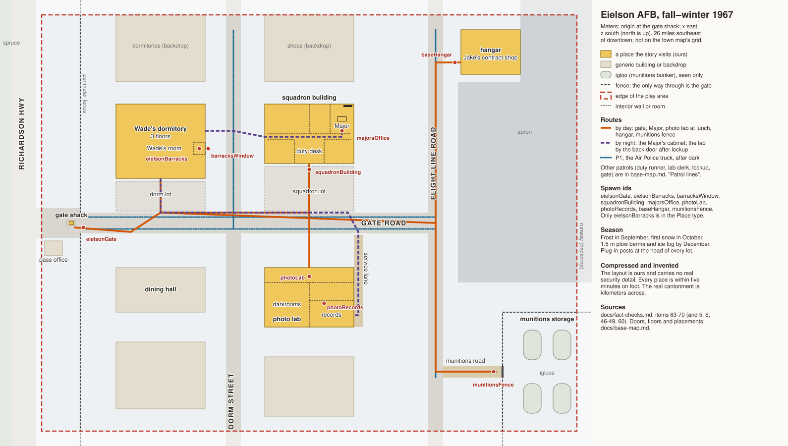

# Eielson Air Force Base, fall and winter 1967: the base map

This is the walkable part of Eielson for Acts 1 to 3 (issue #124): the gate, Wade's barracks, the squadron building
with the duty desk and the Major's office, the photo lab and its records room, the munitions storage area seen from
its fence, and the hangar where Jake does contract maintenance. It is compressed for play the way
[`town-map.md`](town-map.md) compresses downtown. It is plausible, not archival: the layout is ours, it carries no
real security detail, and anything a veteran would question has a fact-check entry in
[`fact-checks.md`](fact-checks.md), items 63 to 70. Where this map and [`design.md`](../design.md) disagree, the design
wins.

The SVG is hand-written in the same meters as the tables below. Its viewBox is the coordinate system, so a value read
off the drawing is a world coordinate. Edit the two together.

## Coordinates

- **Units:** meters.
- **Origin:** the center of the gate shack, on the gate road's centerline.
- **Axes:** x east, z south, y up. North is −z. In the SVG, x is x and y is z.
- **Rectangles:** written as `x0..x1, z0..z1`.
- **Yaw:** placements use 0° or 180°, with the same rule as the town map: at 180°, world = (cx − local x, cz − local z).

This is a separate space from downtown. Its coordinates have nothing to do with the town map's; the 26 miles of
Richardson Highway between them are a cut (a cab, a borrowed truck, the crew bus), never walked.

## Footprint

Design calls the base one of the "discrete levels" beside the downtown hub. It only has to hold the beats the story
puts on it, so it is one small cantonment: a gate, one street of buildings behind it, and the edge of the flight line.
Everything else on a real base (the runway, the alert hangars, base housing, the hospital, the BX, the theater) is
backdrop or left out.

| | Value |
|---|---|
| Play area | x −20..340, z −140..140 (360 × 280 m) |
| Walkable | the gate apron, the gate road, Dorm Street, Flight Line Road, the lots and the snow between buildings, the near edge of the apron |
| Interiors | Wade's room, the squadron building (duty desk, hall, the Major's office), the photo lab (counter, darkrooms, records room), the hangar floor |
| Fenced, seen only | the munitions storage area, east of its gate at x 290 |
| Backdrop only | the Richardson Highway and the spruce flats west of the gate; the runway and the open apron east of x 340; base housing and the rest of the base past the north and south edges; the Alaska Range on a clear day, far south |

### Streets

All names are ours. The real base's street names were not checked and are not needed.

| Street | Right of way | Surface (fall 1967, plausible) | Notes |
|---|---|---|---|
| The Richardson Highway | x −40..−24 | paved, two lanes | west of the play edge, backdrop; Fairbanks is north (−z), Delta Junction south |
| Gate road | z −7..7, roadway z −5..5 | paved | runs east from the highway through the gate to Flight Line Road; walks on both sides inside the fence |
| Dorm Street | x 104..114 | paved | north-south, the cantonment's cross street |
| Flight Line Road | x 240..250 | paved | north-south along the apron's west edge |
| Munitions road | z 96..104, x 250..290 | gravel, plowed | east from Flight Line Road to the storage area's gate |
| Service lane | x 190..196, z 8..70 | gravel | behind the photo lab; its back door opens onto it |

### The fence

A chain-link fence, 2.4 m with a barbed-wire top, runs north-south at x 6 across the whole play area except the gate
road (z −7..7). West of it is the gate apron and the highway shoulder. The map shows the fence as a boundary and
gives no way through it but the gate; it is a wall in the engine, not a puzzle.

The munitions storage area has its own fence, the same height, along x 290 for z 60..140 and along z 60 for
x 290..340, with a closed vehicle gate across the munitions road at x 290.

## Ground and season

### Ground

The base sits on flat gravel outwash. Grade is **y 0 everywhere**; there is no slope worth modeling.
**Buildings:** floor = 0.3, as downtown. An upper floor is 3.0 more per storey.

### Snow and cold by beat

Acts 2 and 3 run from September 1967 to early January 1968. The base beats end in December; Joan's letter (`a3_joan`, 3 January) is in town. The map is the same; what lies on it changes.

| Month | Beats on base | Ground | Light and air |
|---|---|---|---|
| August | the letter home (`a1_letter`) | dry, dust on the lots | long evening light at 20:30 |
| September | the Major (`a2_major`), the photo lab (`a2_photos`) | frost, ice in the puddles by morning (the scene's own line) | daylight about 12 hours |
| October | the Major's cabinet (`a2_co_heist`, `a2_co_lucy`) | first snow, 5 to 10 cm, plowed off the roads | dark by early evening |
| November | Jake at the hangar (`a2_jake`) | 20 to 30 cm; plow berms 1 m along the roads | about six hours of daylight |
| December | the munitions plan (`a3_rash_safe` opens with it; the scene is placed at Tolliver's office), Lucy's call from outside the gate (`a3_rash_none`, `a3_walk`), the search call (`a3_search` opens with it; the scene is placed on the search ridge) | 40 to 50 cm; berms 1.5 m; packed snow on the walks | about four hours of sun (item 54); ice fog over the flight line below −30 |

The berms matter for play: from November on, a 1.5 m berm along each road hides a crouching figure from the road and
shows them to anyone on a walk. Plug-in posts stand along the head of every parking lot, one per stall, with cords
running to the grilles of the cars that are there. Moral weather (design, "Moral weather") picks the time of day; the
map does not.

## Places

All buildings are ours. Building types follow [Building types](#building-types).

| Id | Place | Rectangle | Front door | Floor (y) | Height |
|---|---|---|---|---|---|
| `eielsonGate` | The gate shack, on an island in the gate road | shack x −1.5..1.5, z −1.2..1.2; island x −3..3, z −1.5..1.5 | windows both ways | 0.3 | 1 floor, 3.5 m, a flat roof and a floodlight |
| | Pass office (visitor passes) | x −18..−6, z 12..22, outside the fence | (−12, 12), north onto the gate apron | 0.3 | 1 floor, 4 m |
| `eielsonBarracks` | Wade's dormitory | x 30..90, z −80..−30 | (60, −30), south onto its lot; side door (90, −62), east | 0.3 | 3 floors, 10.5 m |
| | Wade's room, ground floor, east end | x 82..90, z −54..−46 | from the dorm's center hall | 0.3 | window on the east wall, (90, −50) |
| | The dorm lot | x 30..90, z −28..−8 | | | plug-in posts along z −27 |
| | Dining hall | x 30..90, z 30..60 | (60, 30), north onto the gate road | 0.3 | 1 floor, 5 m |
| `squadronBuilding` | The squadron building (Wade's squadron) | x 130..190, z −80..−40 | (160, −40), south onto its lot; back door (130, −58), west onto the Dorm Street side | 0.3 | 1 floor, 4.5 m |
| | The squadron lot | x 130..190, z −38..−8 | | | the Major's staff car's stall at (186, −30), nearest the door |
| `majorsOffice` | The Major's office, inside the squadron building | x 174..190, z −80..−60 | (182, −60), from the hall | 0.3 | window on the north wall |
| `photoLab` | The base photo lab | x 130..190, z 30..70 | (160, 30), north onto the gate road; back door (190, 62), east onto the service lane | 0.3 | 1 floor, 5 m, few windows |
| `photoRecords` | The records room, at the back of the photo lab | x 160..190, z 52..70 | (170, 52), from the lab's hall | 0.3 | no windows |
| `baseHangar` | The hangar where Jake does contract maintenance | x 262..302, z −130..−100 | big doors on the south face, x 266..298, onto the apron; personnel door (262, −108), west onto Flight Line Road | 0.3 | 1 high floor, 12 m, steel arch |
| `munitionsFence` | The munitions storage area, from outside its gate | gate across the munitions road at x 290, z 96..104 | | | igloos: low earth mounds, 4 m, inside at x 300..340, z 70..140 |

`eielsonBarracks` (the Act 1 letter), `majorsOffice`, `squadronBuilding`, `photoLab`, `photoRecords` and `baseHangar`
(Act 2, #90; Act 3's knock, confession and walk out, #91) are in the `Place` type (`text-game/src/types.ts`). `eielsonGate` and `munitionsFence` are still
proposals: they enter the type when a scene sets them.

### Interiors

**Wade's room** (8 × 8): two bunks, two wall lockers, a desk under the window, a footlocker at the foot of Wade's
bunk (the cut piece of line lives there; `a2_curly`). The roommate is on another shift and never home when it matters.
The window, on the east wall, looks across 14 m of snow at Dorm Street. It is where Lucy knocks at midnight in Act 3.

**The squadron building:**

| Part | Rectangle | What is there |
|---|---|---|
| Entry and duty desk | x 150..170, z −56..−40 | the front door, a counter, a desk lamp, a phone, the duty log; the one room lit after hours |
| Hall | x 132..188, z −60..−56 | runs the length of the building; the duty desk's window looks into it at x 150..170 |
| Offices south of the hall, west | x 132..150, z −56..−40 | the first sergeant, a supply cage; dark after hours |
| Offices north of the hall | x 132..174, z −80..−60 | the orderly room (the clerk's typewriter), a briefing room |
| The Major's office | x 174..190, z −80..−60 | desk at (182, −70) facing the door; the cabinet against the north wall at (186, −78); the boat photo, the Florida brochure and the calendar with the retirement date circled in red on the desk (`a2_co_heist`) |
| Back door | (130, −58) | the hall's west end; opens onto the snow strip toward Dorm Street |

The cabinet is a four-drawer steel file cabinet with a combination lock-bar, not a safe (item 48).

**The photo lab:**

| Part | Rectangle | What is there |
|---|---|---|
| Counter | x 150..170, z 30..40 | the clerk's counter, the sign-in book, print orders |
| Darkrooms and print room | x 130..160, z 40..70 | red safelights, trays, the dryers' hum |
| Lab hall | x 160..190, z 40..52 | the way back; the records room's door at (170, 52) |
| Records room | x 160..190, z 52..70 | floor-to-ceiling flat drawers, filed by flight line and frame number; the index card cabinet by the door (`a2_photos_files`) |
| Back door | (190, 62) | onto the service lane; the door the duty sergeant checks at lockup |

**The hangar:** a concrete floor, x 262..302, z −130..−100; a light single-engine plane up on jacks with its cowling
off, a workbench and parts racks along the west wall, a coffee can of bolts, a space heater. The personnel door is a
standard 2.1 m door, which is why Jake, at six foot seven, ducks under it (`a2_jake`).

## Routes

Walk times assume Wade on foot at 1.3 m/s, slower in deep snow.

| Leg | Beat | Path (waypoints) | Length | What the player passes |
|---|---|---|---|---|
| Gate to barracks | arrival (by cab or bus, any act) | (2, 3) inside the gate, east on the south walk to (40, 6), across the road to (60, −7), north up the dorm lot to (60, −30) | about 80 m, 1 minute | the AP at the shack, the pass office behind, the dorm lot's plug-in posts |
| Barracks to the Major | `a2_major`, morning | (60, −30), (60, −7), east on the gate road's north walk to (160, −7), north across the squadron lot to (160, −40) | about 155 m, 2 minutes | Dorm Street, the squadron lot and the Major's car in its stall |
| Squadron to the photo lab, at lunch | `a2_photos`, lunch | (160, −40), (160, −7), across the gate road to (160, 8), south to the lab door (160, 30) | about 70 m | the clerk walking the other way toward the dining hall (patrol P3) |
| Photo lab by the back door, after lockup | `a2_photos`, borrowed key | (60, −30), (60, −7), east on the gate road to (186, −7), across to the service lane's mouth (193, 6), south down the lane to (193, 62), the back door (190, 62) | about 230 m, 3 minutes | the dark lab; the service lane is out of the gate road's sight line behind the building |
| Barracks to the Major's office, at night | `a2_co_heist` | the dorm's side door (90, −62), east across the snow to (109, −62), across Dorm Street to the squadron's back door (130, −58), east along the hall to (182, −60) | about 100 m | the AP truck's lights on Dorm Street (P1); the duty desk's window halfway down the hall (P2) |
| Lucy on the crew | `a2_co_lucy` | the crew's truck stops at the shack (0, 3), parks in the squadron lot at (140, −20); Lucy in by the front door, the hall to the Major's office; out by the back door (130, −58) to Dorm Street, where the AP truck sees her at (109, −58) | | the scene's "spotted on the way out" is fixed at the back door, on the AP truck's loop |
| To the hangar | `a2_jake` | (60, −30), east on the gate road to (245, 0), north on Flight Line Road to (245, −108), the hangar's personnel door (262, −108) | about 370 m, 5 minutes | the squadron building, the apron opening east, the hangar's big doors |
| To the munitions fence | `a3_rash_safe` (seen from outside) | (60, −30), east on the gate road to (245, 0), south on Flight Line Road to (245, 100), east on the munitions road to the gate (286, 100) | about 340 m | the igloos behind the fence; the lifting itself happens inside, on Wade's shift, and is a cut |
| Lucy's call from the gate | `a3_rash_none`, midnight | Wade's room, the CQ runner at the door; down the dorm lot from (60, −30) to (60, −7), across to the south walk (40, 6), west past the shack (2, 3) to the car outside it | about 80 m, 1 minute | Lucy can't get onto the base: she calls from the pay phone outside the gate and never comes past the shack |
| The search call | `a3_search` | Wade's room, (60, −30), east to the apron outside the hangar, (280, −90), where the ground team's truck loads | about 390 m | the apron under floodlights and ice fog |

## Patrol lines

These are for the heists (`a2_photos`, `a2_co_heist`, `a2_co_lucy`). They are game patrols, not a real base's
security plan: one truck, a duty runner, and the people whose habits the scenes already name.

| Id | Who | Path | Timing | Notes |
|---|---|---|---|---|
| P1 | Air Police pickup truck | (10, 4) east to (109, 4), north on Dorm Street to (109, −130), back to (109, 4), east to (245, 4), south to (245, 104), north to (245, −130), back to (245, −4), west to (10, −4) | one loop about 1,150 m at 4 m/s, about 5 minutes, after dark only | headlights and a spotlight; its two passes up Dorm Street are what the night routes are timed against |
| P2 | The duty runner (charge of quarters) | duty desk (160, −48) → hall west end (134, −58) → hall east end (186, −58) → back | every 20 minutes after hours | a flashlight on each office door; the desk lamp is always on, and the window onto the hall is the gauntlet |
| P3 | The photo lab clerk | counter (160, 35) → (160, 8) → west on the south walk → dining hall door (60, 30), and back | leaves 1200, back about 1245 | "takes a long lunch" (`a2_photos`); while P3 is in the dining hall the counter is empty |
| P4 | The duty sergeant at lockup | lab front door (160, 30) → around the east side by the service lane → back door (190, 62) → out to the gate road and west | 1700 sharp, once | locks both doors; after P4 the lab is dark until morning |
| P5 | The gate | one AP at the shack; one walking the apron x −10..6 | always | stops every vehicle in; the crew truck in `a2_co_lucy` is stopped here and waved through |
| P6 | Munitions area | a truck's lights moving along the inside of the storage fence | seen, never reached | dressing only; the map does not say how the storage area is guarded |

## Spawn points

Facing is a unit vector (x, z); (0, −1) faces north. y is the floor or the grade (0).

| Id | Position (x, y, z) | Facing | Notes |
|---|---|---|---|
| `eielsonGate` | (8, 0, 3) | (1, 0) | just inside the gate on the inbound side, looking down the gate road |
| `eielsonBarracks` | (86, 0.3, −50) | (1, 0) | Wade's room, at the desk, facing the window; the Act 1 letter and the Act 3 knock both start here |
| `barracksWindow` | (92, 0, −50) | (−1, 0) | outside the window in the snow, facing in; for a scene from Lucy's side |
| `squadronBuilding` | (160, 0, −36) | (0, −1) | the squadron lot, facing the front door |
| `majorsOffice` | (182, 0.3, −62) | (0, −1) | just inside the office door, facing the desk and the cabinet |
| `photoLab` | (160, 0.3, 36) | (0, 1) | inside the front door, at the counter |
| `photoRecords` | (170, 0.3, 54) | (0, 1) | inside the records room door, facing the drawers |
| `baseHangar` | (258, 0, −108) | (1, 0) | Flight Line Road outside the personnel door, where Jake catches Wade |
| `munitionsFence` | (284, 0, 100) | (1, 0) | on the munitions road at the closed gate, looking through the fence at the igloos |

## Building types

What an airman would expect (item 64):

- **Concrete dormitories, three storeys:** 1950s, flat-roofed, long center halls, rooms for two to four airmen.
  Wade's is one of several; the others are backdrop north and south.
- **One-storey concrete-block and frame buildings:** the squadron building, the photo lab, the dining hall, the pass
  office. Painted, flat or low-pitched roofs, numbered on the end wall.
- **Steel hangars:** arched or gabled, with big sliding doors onto the apron.
- **Igloos:** earth-covered munitions bunkers, low grassy (in winter, snowy) mounds with a concrete headwall and a
  steel door, behind their own fence (item 60).
- **Steam:** the base is heated from a central plant. Steam lines and the ventilation stacks of the buried utility
  runs show as bare, snow-free strips and plumes in deep cold (item 64). Dressing, not routes.

## Who is on base

- **Airmen** of every squadron, mostly young, mostly from Outside; Wade among them. In parkas, mukluks or bunny boots
  from November.
- **Air Police** at the gate and in the truck (P1, P5).
- **Civilian workers:** contract mechanics like Jake, the dining hall's civilian cooks, and the custodial crews that
  clean the offices at night (item 47). Lucy's cousin is on one of those crews. Fairbanks people with base jobs,
  Native people among them, are ordinary here, not exotic.
- **Officers:** the Major, and others seen across the lot. Nobody salutes indoors.

Lucy on base is a risk to Lucy (design, "Heat": the flag for Lucy if she's seen on base). The map should make her
visible where the scene makes her seen, and nowhere else.

## Scale and compression

- **Kept:** the order of things a visitor meets (the highway, the gate, the cantonment, the flight line); a munitions
  area well away from the barracks and behind its own fence; walk times short enough that a heist fits a lunch hour.
- **Compressed:** everything. The real cantonment is kilometers across, and the munitions area is much farther from
  the barracks than 300 m. Here every place the story visits is within five minutes on foot.
- **Dropped:** the runway, the alert and reconnaissance aircraft, base housing, the hospital, the BX and commissary,
  the chapel, and the Army's training areas.
- **Not modeled:** any real gate procedure, fence line, alarm or guard post. Patrols are game patrols.

## What's real, what's ours

**Real** (item numbers refer to [`fact-checks.md`](fact-checks.md)):

- Eielson Air Force Base, about 26 miles southeast of Fairbanks off the Richardson Highway, with a long runway and a
  1967 host unit, the 5010th Combat Support Group (items 5, 11).
- Air Police at the gate, igloos for munitions storage, a base photo lab on a reconnaissance base (items 6, 46, 60,
  63).
- Civilian contract workers and custodial crews on base (item 47).

**Ours:**

- The whole layout: the gate road, Dorm Street, Flight Line Road and every building's spot and size.
- The squadron building, the Major's office and its cabinet; Wade's dormitory and room; the photo lab's plan and its
  records room; the hangar; the patrols.
- Which squadron Wade belongs to and what it is called (item 65).

## Open questions

- Where on the real base were the main gate, the dormitories and the flight line in 1967, relative to each other
  (item 64)? This map only needs the order to be right.
- Did Eielson in 1967 have a squadron whose commander would be a major and whose airmen were munitions specialists
  (item 65)? The design's "Wade's CO" needs one.
- Was there a photo lab at Eielson that held prints of Interior mapping flights, and in which unit (items 6, 46, 66)?
- Where was the munitions storage area, and could a road near the barracks see it (item 67)?
- Would a civilian bush mechanic do contract maintenance in a base hangar, and on what aircraft (item 68)?
- Rooms or open bays for a 19-year-old airman in 1967, and could his room be on the ground floor (item 69)?
- Who sat the duty desk in a squadron building at night (item 70)?
