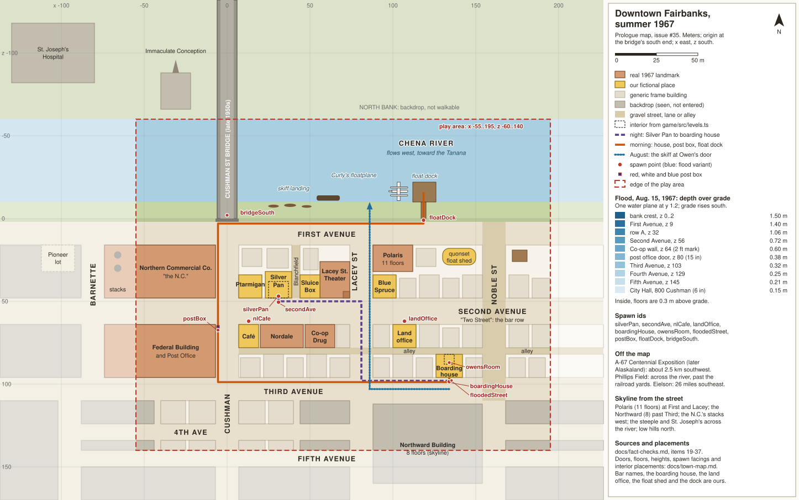

# Downtown Fairbanks, summer 1967: the town map

The walkable downtown for the prologue (issue #35), and the same blocks under the August flood. It is meant to hold
up to someone who lived there (plausible, not archival). Every landmark has a fact-check entry in
[`fact-checks.md`](fact-checks.md) (items 19 to 37). Where this map and [`design.md`](../design.md) disagree, the
design wins.

The SVG is hand-written in the same meters as the tables below: its viewBox is the coordinate system, so a value
read off the drawing is a world coordinate. Edit the two together.

## Coordinates

- **Units:** meters.
- **Origin:** the south end of the Cushman Street bridge, on the bridge centerline, where the deck meets First
  Avenue's river-side curb.
- **Axes:** x east, z south, y up. North is −z. In the SVG, x is x and y is z.
- **Rectangles** are given as `x0..x1, z0..z1`.
- **Ground height (y):** the town is not flat in this model. It rises about a meter from the riverbank to Fifth
  Avenue, too gently to see, so that one flat flood plane gives the right depth on every block (see
  [The flood](#the-flood-august-1967)). Summer river surface: y = −3.5. Riverbank top: y = −0.3.

## Footprint

Signed off by the owner: the Chena riverfront from the Cushman Street bridge a few blocks west, First to Third
Avenue, and Cushman Street up to about Fifth. Most of the action is on the water or in the bars and buildings on
Second Avenue.

| | Value |
|---|---|
| Play area | x −195..55, z −60..140 (250 × 200 m) |
| Walkable | the south bank, First to Third Avenue between Noble Street and the east edge, Cushman Street to Fifth |
| On the water | the river inside the play area (skiffs, the float dock, the plane) |
| Backdrop only | the north bank (church, hospital), the Northward Building, everything past the edges |

### Streets

The river is straightened to run east-west; in town it bends, and First Avenue bends with it.

| Street | Right of way | Surface (1967, plausible) | Notes |
|---|---|---|---|
| First Avenue (old Front Street) | z 2..16; roadway z 5..13 | paved; river-side walk | runs along the south bank |
| Second Avenue ("Two Street") | z 48..64; roadway z 52..60 | paved, concrete walks | the bar row; widest street on the map |
| Third Avenue | z 96..110; roadway z 99..107 | paved | Owen's boarding house faces it |
| Fourth Avenue | z 124..134 (x −40..40 open) | paved | a stub; backdrop past it |
| Fifth Avenue | z 140..150 | paved | just past the south edge; seen, not reached |
| Cushman Street | x −7..7; roadway x −4..4 | paved, concrete walks | lines up with the bridge |
| Lacey Street | x −88..−74 | paved | first street west of Cushman (order to verify, item 19) |
| Noble Street | x −168..−154 | gravel | second street west; edge of the dense blocks |
| Blanchfield lane | x −44..−39, z 16..48 | gravel | a real little street between Cushman and Lacey; the Silver Pan's side door opens on it |
| Alleys (row B) | z 78..82, x −195..−7 | gravel | behind Second Avenue's south side and Third's north side |

### Blocks

| Id | Between | Rectangle |
|---|---|---|
| A1e | 1st–2nd, Blanchfield–Cushman | x −39..−7, z 16..48 |
| A1w | 1st–2nd, Lacey–Blanchfield | x −74..−44, z 16..48 |
| A2 | 1st–2nd, Noble–Lacey | x −154..−88, z 16..48 |
| A3 | 1st–2nd, west of Noble (edge) | x −195..−168, z 16..48 |
| B1 | 2nd–3rd, Lacey–Cushman | x −74..−7, z 64..78 and z 82..96 |
| B2 | 2nd–3rd, Noble–Lacey | x −154..−88, z 64..78 and z 82..96 |
| B3 | 2nd–3rd, west of Noble (edge) | x −195..−168, z 64..78 and z 82..96 |
| E1 | 1st–2nd, east of Cushman | x 7..55, z 16..48 |
| E2 | 2nd–3rd, east of Cushman | x 7..55, z 64..96 |
| C1, C2 | 3rd–4th, one lot deep on Cushman | x −40..−7 and x 7..40, z 110..124 |
| D1, D2 | 4th–5th, one lot deep on Cushman | x −40..−7 and x 7..40, z 134..140 |

## Places

### Real landmarks

| Place | Where | Rectangle | Height | What it looks like in 1967 |
|---|---|---|---|---|
| Cushman Street bridge | over the river on Cushman | x −6..6, z −60..0 (and north, off the play area) | deck about y 3 | the 1960 span, two lanes and walks; not the old 1917 steel truss, which was gone |
| Northern Commercial Co. ("the N.C.") | E1, First Avenue east of Cushman | x 7..55, z 16..48 | 2 floors | the town's big department store; its power plant's two stacks stand off the map to the east |
| Polaris Building | A1w, First and Lacey | x −74..−50, z 16..34 | 11 floors, about 35 m | apartments, 1952; the tallest thing in town |
| Co-op Drug | A2, Second Avenue just west of Lacey | x −112..−90, z 28..48 | 2 floors | concrete, built 1927 as the Empress Theater; drugstore with a fountain-lunch counter |
| Nordale Hotel | B1, south side of Second between Cushman and Lacey | x −62..−23, z 64..78 | 3 floors | the 1920s rebuild after the first Nordale burned; a social landmark until it burned in 1972 |
| Lacey Street Theater | B2, Second and Lacey | x −118..−88, z 64..78; tower x −92..−88, z 64..68 | 2 floors, 4-storey stepped corner tower | Art Deco concrete, 1939–40; rebuilt inside after a 1966 fire |
| Federal Building and Post Office | E2, Cushman between Second and Third | x 7..55, z 64..96 | 3 floors | concrete, 1933; the post office where Owen mails the letter |
| Gravel lot (Pioneer Hotel site) | A1e, First and Cushman | x −25..−7, z 16..32 | none | the Pioneer Hotel burned in 1952; we keep its corner as an empty lot |
| Immaculate Conception church | north bank, by the bridge's north end | x −40..−22, z −88..−66 | steeple about 15 m | white frame church, moved across the river from downtown in 1911 to be near the hospital; backdrop |
| St. Joseph's Hospital | north bank, a little downstream (west) of the church | x −175..−120, z −118..−82 | 4 floors | Sisters of Providence; flooded and evacuated in August; backdrop |
| Northward Building | south of Third between Lacey and Noble | x −154..−88, z 112..160 | 8 floors, about 26 m | the "Ice Palace" of Ferber's novel, 1952; backdrop |

Off the map:

- **The Alaska 67 Centennial Exposition** ("A-67"), on Airport Way at Peger Road, about 2.5 km southwest. It ran
  through the summer of 1967 and was renamed Alaskaland afterward, so in July people say "A-67", "the Centennial"
  or "the Exposition", not "Alaskaland".
- **Phillips Field**, the bush strip on the north side of the river beyond the railroad yards, where most small
  operators were based. Curly's hangar belongs there.
- **Eielson Air Force Base**, about 26 miles southeast.

### Ours

| Id | Place | Where | Rectangle | Notes |
|---|---|---|---|---|
| `silverPan` | The Silver Pan | A1e, north side of Second Avenue, on the Blanchfield lane corner | x −39..−23, z 32..48 | one storey, false front, frame. The bar room is the existing 12 × 10 m interior (`game/src/levels.ts`, `bar`), centered at (−30, 43) with its door to the south on Second Avenue. Back room and storage z 32..38. Side door onto the lane at (−39, 36). |
| | The Ptarmigan (bar) | A1e, corner of Second and Cushman | x −21..−7, z 34..48 | neighbor; dressing |
| | The Sluice Box (bar) | A1w, Second Avenue | x −60..−44, z 34..48 | neighbor; dressing |
| | The Blue Spruce Lounge | A1w, corner of Second and Lacey | x −74..−60, z 34..48 | neighbor; dressing |
| `nlCafe` | Northern Lights Café | B1, corner of Second and Cushman | x −21..−7, z 64..78 | Dottie's counter (design canon); door on the corner |
| `landOffice` | The land office | B1, Cushman at Third | x −21..−7, z 82..96 | Lucy's office. A storefront with its door on Cushman, across the street from the post office. Whether the federal land office sat in the Federal Building in 1967 is open (item 30); a storefront keeps us out of that question. |
| `boardingHouse` | Owen's boarding house | B2, north side of Third Avenue | x −142..−126, z 82..96 | two-storey frame rooming house; door at (−134, 96) on Third |
| `owensRoom` | Owen's room | upstairs, back of the boarding house | 6 × 6 m centered (−134, 86), floor y 3.7 | the existing `room` interior; its window (north wall) looks over the gravel alley |
| | Quonset float shed | A2, First Avenue | x −150..−130, z 18..28 | surplus quonset where the float operator keeps fuel drums, lines and paddles |
| `floatDock` | The float dock | south bank between Lacey and Noble | float x −126..−112, z −18..−6; gangway x −120..−117, z −6..2 | log-and-plank float on a hinged gangway; rides up with the water |
| | Curly's floatplane | moored west of the float | about x −141..−130, z −17.5..−6.3 | high-wing bush plane on floats, nose east (upstream, into the current) |
| | Skiff and riverboat landing | south bank, west of the bridge | x −66..−22, z −10..−4 | village skiffs and a freight boat tied up or pulled onto the bank |

Generic buildings (pale on the map) are unnamed frame storefronts, rooming houses, cabins and sheds. See
[Building types](#building-types).

## The prologue route

Night is the July night of the bar scene: the sun is still up at eleven, so "night" is a low gold light, not dark.

| Leg | Path (waypoints) | Length | What the player passes |
|---|---|---|---|
| Night: Silver Pan → boarding house | (−30, 47.6) door → (−30, 50) → west on Second's north walk → (−81, 50) Lacey → south on Lacey → (−81, 98) → west on Third → (−134, 98) → (−134, 96) door | about 156 m, 2 minutes on foot | the Sluice Box and the Blue Spruce, the Co-op's windows across Lacey, the Lacey Street Theater's tower and marquee, the gravel alley |
| Morning: boarding house → post box → float dock | (−134, 96) → (−134, 98.8) → east on Third → (5.5, 98.8) Cushman's east walk → north on Cushman → post box at (5.5, 66) → (5.5, 3) First Avenue → west on the river walk → (−118.5, 3) → gangway → (−118.5, −12) float | about 380 m, 4 to 5 minutes | the land office's window, the Federal Building, the N.C., the bridge, the empty Pioneer lot, the Polaris, the skiff landing, the float shed |
| August: the skiff | skiff waits at (−134, 103) on flooded Third; leaves east to Lacey and north toward the river | | the night route's blocks under water; where the ride ends is the story's, not the map's |

The post box is a street collection box at the curb by the Federal Building, painted red, white and blue (the colors
of the time; item 30).

## Spawn points

Facing is a unit vector (x, z); (0, −1) faces north.

| Id | Position (x, y, z) | Facing | Notes |
|---|---|---|---|
| `silverPan` | (−30, 0.3, 46.9) | (0, −1) | inside the door; the same spot as `bar.spawn` (0, 3.9) in local space |
| `secondAve` | (−30, 0.6, 50.5) | (−1, 0) | on Second's north walk outside the Silver Pan; the night walk starts here |
| `boardingHouse` | (−134, 0.8, 98.5) | (0, −1) | Third's north walk, facing the door; the morning walk starts here |
| `owensRoom` | (−134, 3.7, 88) | (0, −1) | the same spot as `room.spawn` (0, 2) in local space |
| `floatDock` | (−118.5, −0.3, 1) | (0, −1) | top of the gangway, looking at the plane |
| `floodedStreet` | (−134, 0.8, 103) | (0, −1) | in Third Avenue in front of the boarding house; water 0.4 m deep, surface y 1.2 |
| `postBox` | (5.5, 0.6, 67.4) | (0, −1) | Cushman's east walk at the box |
| `landOffice` | (−5.5, 0.7, 89) | (−1, 0) | Cushman's west walk at Lucy's door |
| `bridgeSouth` | (0, 3.0, −2) | (0, 1) | on the deck at the south end, looking into town |
| `nlCafe` | (−5.5, 0.6, 66) | (−1, 0) | outside Dottie's corner door (not drawn) |

Interiors keep their own local coordinates in `game/src/levels.ts`. To place one in town: world = local + the
interior's center above, with the interior's +z wall toward the street door.

## The flood (August 1967)

The Chena came over its banks on August 14 and crested at Fairbanks on August 15. Depths below are water over
grade at the crest, by band, anchored on the downtown high-water marks (item 34). A flood variant uses one flat
water plane at **y = 1.2** over the rising ground in the table; that gives these depths without stepped water.

| Band | z range | Ground y | Water depth | Anchor |
|---|---|---|---|---|
| Riverbank | −4..2 | −0.3 | 1.5 m | "about five feet" near the river |
| First Avenue | 2..16 | 0.0 | 1.2 m | Cushman at the bridge: canoes and motorboats in 3 to 4 feet |
| Row A (1st–2nd) | 16..48 | 0.3 | 0.9 m | interpolated; "one and a half to three feet" over most of downtown |
| Second Avenue | 48..64 | 0.6 | 0.6 m | the Co-op Plaza mark on Second, about 2 feet |
| Row B (2nd–3rd) | 64..96 | 0.7 | 0.5 m | interpolated |
| Third Avenue | 96..110 | 0.8 | 0.4 m | the old post office mark at Cushman and Third, about 15 inches |
| Row C (3rd–4th) | 110..124 | 0.9 | 0.3 m | interpolated |
| Fourth Avenue | 124..134 | 1.0 | 0.2 m | interpolated |
| Fifth Avenue | 134..150 | 1.05 | 0.15 m | the mark on Cushman near Fifth (old City Hall), about 6 inches |

What changes on these blocks:

- The river is over the bank and First Avenue is part of it; the bank, the skiff landing and the float shed's floor
  are under 1.2 to 1.5 m of brown, moving water. The float dock rides up on its gangway; the plane is gone.
- The bar row stands in water to the knee or thigh. Doors are open or sandbagged; trash, boards and fuel drums
  drift. People pole and motor skiffs up the streets.
- At Owen's door on Third the water is a shin-to-knee 0.4 m, enough to float a skiff with the motor tilted up.
- Across the river St. Joseph's is being evacuated; the church stands in water.
- Interiors on the ground floor take on the band's depth plus a little (floors are about 0.3 m above grade).

## Building types

What a local would expect on these blocks (item 33):

- **Frame false-fronts:** one or two storeys, clapboard or board-and-batten, a square front hiding a gable roof.
  Most of the bars and small shops, the Silver Pan included.
- **Concrete and brick, two to three storeys:** the Co-op (1927), the Lacey Street Theater (1939), the Federal
  Building (1933), the N.C.
- **The 1952 high-rises:** the Polaris and the Northward, plain concrete slabs that dwarf everything.
- **Quonset huts:** postwar surplus, used as sheds, garages and warehouses on back lots and near the river.
- **Log cabins:** a few survive at the edges of downtown (the Gould cabin on Dunkel Street, about 1910, is real);
  for us, one or two in the backdrop west of Noble.

Surfaces: the main avenues and Cushman are paved with concrete walks; Noble, the lane and the alleys are gravel,
with a few board walks left on older frame blocks. July is dust: gravel streets, trucks and the summer's
construction. In August, mud.

## Who is in town in July

The crowd should be honest about who was downtown, and ordinary. All of this is for consultant review (item 36).

- **Village families on ordinary business:** in on the river or by air to buy supplies at the N.C. and the Co-op,
  see a doctor, or visit relatives in St. Joseph's.
- **People working:** riverboat and barge crews at the landing (Eli is one of them), summer firefighting crews from
  the villages passing through town, people with jobs in town.
- **Golden Days:** the town's July festival, with the games that began in 1961 as the World Eskimo Olympics held on
  the Chena's bank downtown. Optional dressing for the riverbank, not canon (item 37).
- **Fairbanks people:** Lower Tanana families who live in town, airmen and soldiers on pass, miners, construction
  crews, tourists in for the Centennial.

Do not use 2nd Avenue's drinking as the setting for Native extras, and do not use the 1960s slur that village crews
set fires for work (it appears in a 1969 magazine piece; item 36).

## Scale and compression

- **Kept:** the order of streets and landmarks, which side of the street each is on (where known), what you can see
  from where, and the walk times that matter: bar to bed about two minutes, bed to dock about five.
- **Compressed:** blocks are about half their real depth north to south; Cushman from Third to Fifth is squeezed
  hardest, because it is a vista, not a play space. The river is narrowed to about 56 m and straightened.
- **Dropped:** everything east of Cushman past the N.C. and the Federal Building; streets west of Noble; Garden
  Island and the railroad north of the river.
- **Estimates to replace:** real block sizes and the river's width were not measured for this pass. The USGS flood
  map (Hydrologic Atlas 294, 1:24,000) or a period Sanborn map would settle both.

## What's real, what's ours

Real (checked, item numbers in [`fact-checks.md`](fact-checks.md)):

- The Chena River, its south-bank First Avenue (once Front Street), Second Avenue's bar row, Third, Fourth and Fifth
  Avenues, Cushman, Lacey and Noble Streets, and the Blanchfield lane (19, 21).
- The 1960 Cushman Street bridge (20).
- The Nordale Hotel, the Lacey Street Theater, the Co-op Drug building, the Northern Commercial Company, the Polaris
  and Northward buildings, the Federal Building and post office (22, 24, 25, 28, 29, 30).
- Immaculate Conception church and St. Joseph's Hospital across the river (26, 27).
- The Pioneer Hotel's absence: it burned in 1952 (23).
- The flood's dates and depths (34); the Centennial Exposition off-map (31); Golden Days and the games (37).

Ours (invented, kept plausible):

- The Silver Pan, the Ptarmigan, the Sluice Box and the Blue Spruce Lounge, and their exact lots.
- Owen's boarding house and room; the land office as a Cushman storefront.
- The float dock's exact spot, the quonset float shed, and Curly's plane. Floatplanes did use the Chena at
  Fairbanks; a 1967 downtown dock is not documented (35).
- The Northern Lights Café's corner (the café is design canon; its lot is ours).
- The sides of the street for the Lacey Street Theater, the Co-op and the Federal Building; the street order west of
  Cushman (19).
- Ground heights and per-block flood depths between the measured marks (34).

## Open questions

- Street order west of Cushman: Lacey then Noble (this map), or the reverse? Sources conflict (item 19).
- Was the Lacey Street Theater open again by July 1967 after the 1966 fire (item 24)?
- Where exactly did floatplanes tie up on the Chena in 1967, and who ran them (item 35)?
- Was the Bureau of Land Management's Fairbanks land office in the Federal Building (item 30)?
- Did the 1967 games during Golden Days still run on the riverbank downtown, and under which name (item 37)?
- How deep was the water inside the bars on Second (floor height above grade)? The Fairbanks Daily News-Miner's
  flood photos, or the National Weather Service's high-water-mark walking tour, would settle it.
